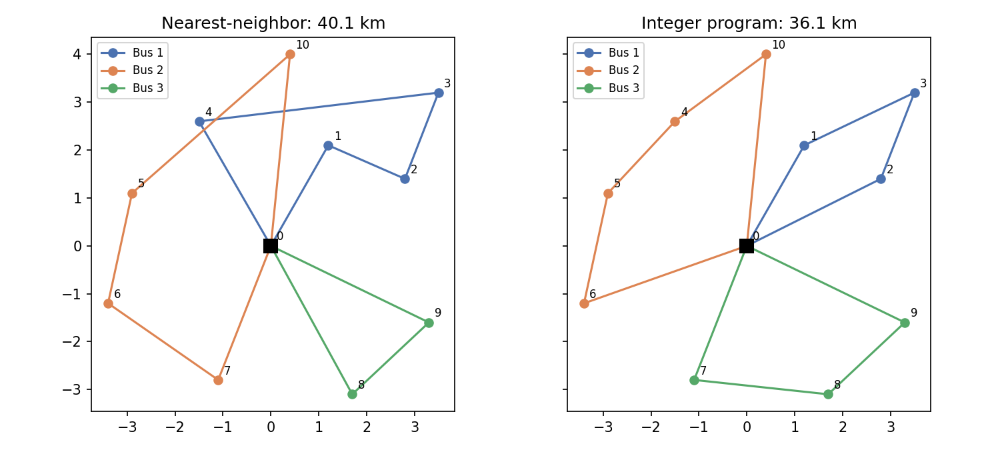

# Stage 3: School Bus Routing (Capacitated Vehicle Routing)

**Question.** Ten bus stops with 58 students total, three buses with 24 seats each. Which stops does each bus serve, and in what order, to minimize total distance?

**Answer.** The nearest-neighbor rule a dispatcher would use drives 40.1 km. The integer program drives 36.1 km, 10% less, with better balanced loads, and proves no plan is shorter.



Left: nearest neighbor sends bus 2 on a long loop because it greedily grabbed the closest stop each time and left Meadow Dr (stop 10) stranded. Right: the optimizer divides the map into three clean wedges.

## The model

This is the two-index formulation of the Capacitated Vehicle Routing Problem (CVRP) with Miller-Tucker-Zemlin (MTZ) load constraints.

**Index sets**

* $N = \{1, \dots, 10\}$ bus stops
* $V = N \cup \{0\}$ where 0 is the school (the depot)

**Data**

* $d_{ij}$: distance from $i$ to $j$ (Euclidean, from coordinates in `data/stops.csv`)
* $q_j$: students waiting at stop $j$
* $K = 3$ buses, $Q = 24$ seats each (`data/config.json`)

**Decision variables**

$$x_{ij} \in \{0,1\} \quad \text{a bus drives directly from } i \text{ to } j \quad (i \ne j)$$

$$u_j \in [q_j, Q] \quad \text{students on board just after picking up stop } j$$

**Objective**

$$\min \sum_{i \ne j} d_{ij} x_{ij}$$

**Constraints**

$$\text{(1) arrive once: } \sum_{i \in V, i \ne j} x_{ij} = 1 \quad \forall j \in N$$

$$\text{(2) leave once: } \sum_{j \in V, j \ne i} x_{ij} = 1 \quad \forall i \in N$$

$$\text{(3) bus limit: } \sum_{j \in N} x_{0j} \le K$$

$$\text{(4) MTZ load: } u_j \ge u_i + q_j - Q(1 - x_{ij}) \quad \forall i, j \in N, i \ne j$$

$$\text{(5) load bounds: } q_j \le u_j \le Q \quad \forall j \in N$$

## Why constraint (4) is the whole trick

Constraints (1) and (2) alone say every stop has one bus arriving and one leaving. That is satisfied by a route that never visits the school at all: a closed loop 1 -> 2 -> 3 -> 1 is perfectly legal under (1) and (2). These disconnected loops are called **sub-tours**, and eliminating them is the hard part of every routing problem.

Look at (4) in its two cases:

* If $x_{ij} = 0$: the constraint reads $u_j \ge u_i + q_j - Q$. Since $u_i \le Q$, the right side is at most $q_j$, and $u_j \ge q_j$ already. **No effect.**
* If $x_{ij} = 1$: the constraint reads $u_j \ge u_i + q_j$. **The load strictly increases** by at least $q_j$ every time the bus moves to a new stop.

Now suppose a sub-tour 1 -> 2 -> 3 -> 1 existed. Following (4) around the loop: $u_2 \ge u_1 + q_2$, $u_3 \ge u_2 + q_3$, $u_1 \ge u_3 + q_1$. Adding these gives $0 \ge q_1 + q_2 + q_3 > 0$, a contradiction. So no loop can avoid the school, because the school is the only node where the load resets (it has no $u$ variable).

At the same time, $u_j \le Q$ means the accumulated load on any route never exceeds the bus. **One constraint family does both jobs.** That is why MTZ is the standard first formulation to learn, even though stronger ones exist for large instances.

## Model to code

| Math | `model.py` |
|---|---|
| $x_{ij}$ | `pulp.LpVariable(f"x_{i}_{j}", cat="Binary")` for all ordered pairs |
| $u_j \in [q_j, Q]$ | `pulp.LpVariable(f"u_{j}", lowBound=q[j], upBound=Q)` |
| (1), (2) | `arrive_{j}` and `leave_{j}` equality constraints |
| (3) | `prob += pulp.lpSum(x[0, j] for j in N) <= K` |
| (4) | `prob += u[j] >= u[i] + q[j] - Q * (1 - x[i, j])` |

Routes are read back by starting at the school and following chosen arcs until the bus returns (`extract_routes`).

## Result

```
Nearest-neighbor baseline: 40.11 km over 3 buses
  Bus 1 (23/24): School -> Maple & 3rd -> Riverside Park -> Oak Hill -> Elm Street -> School
  Bus 2 (24/24): School -> Station Rd -> Pine Court -> Library -> Meadow Dr -> School
  Bus 3 (11/24): School -> Birch Lane -> Cedar Ave -> School

Optimized (proven optimal): 36.11 km over 3 buses
  Bus 1 (19/24): School -> Maple & 3rd -> Oak Hill -> Riverside Park -> School
  Bus 2 (22/24): School -> Pine Court -> Library -> Elm Street -> Meadow Dr -> School
  Bus 3 (17/24): School -> Station Rd -> Birch Lane -> Cedar Ave -> School
```

Model size: 110 binary arc variables, 10 continuous load variables, 90 MTZ constraints. CBC proves optimality in about 6 seconds.

## Sensitivity: questions the model can answer

Each is a one-line change to `data/config.json` or `stops.csv`:

* **What if a bus breaks down?** Set `buses` to 2. Total capacity 48 < 58 students, so no plan exists. A one-line check ($K \cdot Q < \sum q_j$) tells you that instantly. The solver, on the other hand, ran for over two minutes without finishing when I tried it, because the LP relaxation stays feasible with fractional arcs and CBC has to exhaust the tree to prove infeasibility. Lesson: always test the obvious necessary conditions before calling the solver.
* **Is a fourth bus worth it?** Set `buses` to 4 and compare the distance saved against the cost of a driver.
* **Smaller buses?** Set `capacity` to 20 and watch the routes fragment.
* **A new stop.** Add a row to `stops.csv`. Nothing else changes.

## Extensions

* Replace Euclidean $d_{ij}$ with road distances from OpenStreetMap via `osmnx`.
* Add a fixed cost per bus to the objective so the model decides how many to run.
* Add ride-time limits: no student on the bus longer than 25 minutes. This needs a second MTZ-style variable for elapsed time.
* At 30+ stops MTZ becomes slow. Compare with Google OR-Tools' routing solver, which uses local search heuristics and scales to thousands of stops.

## Run

```bash
python -m stage3_bus_routing.run
python -m pytest tests/test_stage3_routing.py -v
```
